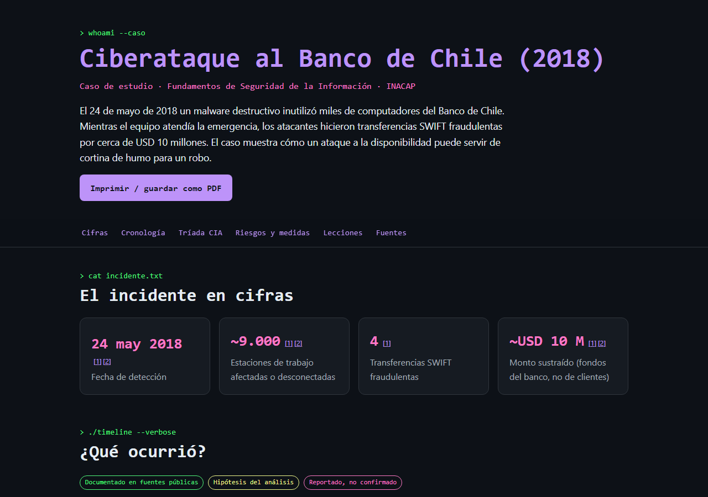
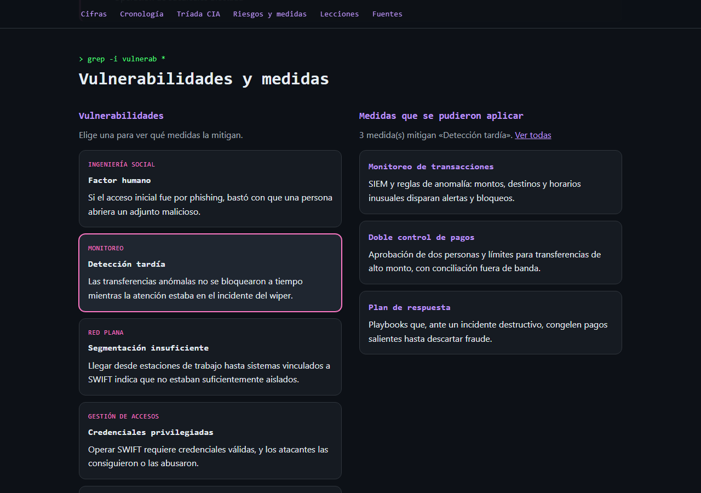
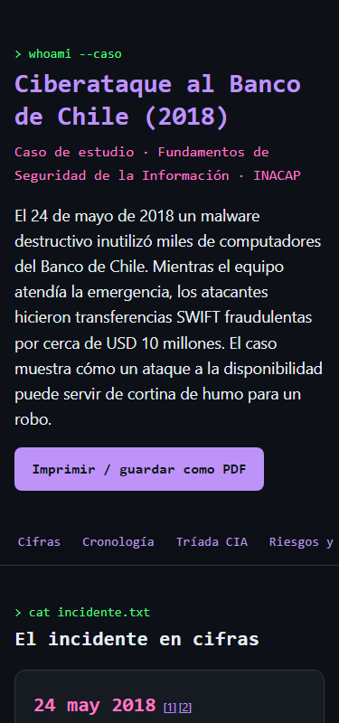

# 🏦 Infografía: ciberataque al Banco de Chile (2018)

[](https://github.com/Fernandamv96/Infografia-.banco/actions/workflows/ci.yml)
[](https://github.com/Fernandamv96/Infografia-.banco/actions/workflows/codeql.yml)


[](LICENSE)

Infografía interactiva sobre el ataque de mayo de 2018 al Banco de Chile: un malware *wiper* inutilizó miles de equipos mientras se ejecutaban transferencias SWIFT fraudulentas por cerca de USD 10 millones. La hice para el ramo **Fundamentos de Seguridad de la Información (INACAP)**.

**Demo:** <https://fernandamv96.github.io/Infografia-.banco/> (la publica el workflow `pages.yml` en cada push a `main`)



## ¿Qué problema resuelve?

Explica un incidente real de forma visual y verificable. Cada afirmación tiene una etiqueta: **documentado** (con fuente), **hipótesis del análisis** o **reportado, no confirmado**. Así se distingue lo que se sabe de lo que se supone.

- **Cronología** desplegable de las fases del ataque.
- **Tríada CIA** en pestañas navegables con teclado (← → Inicio Fin).
- **Vulnerabilidades → medidas**: al elegir una vulnerabilidad se ven las medidas que la mitigan.
- **Fuentes citadas** con referencias numeradas.
- Botón de **impresión / PDF** con estilos de impresión propios.

<details>
<summary>Más capturas</summary>

| Interacción vulnerabilidad → medidas | Móvil |
|---|---|
|  |  |

</details>

## Stack

React 19 · Vite 8 · CSS propio (sin framework) · ESLint · `node:test` · GitHub Actions + GitHub Pages

## Cómo correrlo localmente

```bash
npm ci
npm run dev       # http://localhost:5173
npm run lint      # ESLint
npm test          # integridad del JSON de datos
npm run build     # build de producción en dist/
```

## Estructura del proyecto

```
src/
├── data/caso-banco-chile.json   # TODO el contenido: cifras, fases, CIA, medidas, fuentes
├── components/                  # Header, SectionNav, Section, Cifras, Timeline,
│                                # CiaTabs, RiesgosYMedidas, SourceRefs, Fuentes
├── App.jsx
├── main.jsx
└── index.css                    # estética terminal + pastel, foco visible, print
tests/data.test.js               # referencias cruzadas válidas en el JSON
```

Para cambiar o ampliar el contenido solo hay que editar el JSON. Los tests verifican que cada referencia a una fuente y cada vínculo vulnerabilidad → medida existan.

## Accesibilidad

- HTML semántico (`main`, `nav`, `section` con `aria-labelledby`) y enlace "Saltar al contenido".
- Acordeón con `aria-expanded`, pestañas con el patrón WAI-ARIA y filtros con `aria-pressed` + `aria-live`.
- Foco visible, contraste AA y `prefers-reduced-motion`.
- Verificado con axe-core (0 violaciones WCAG 2.1 AA) y sin scroll horizontal a 375 px.

## Qué aprendí

- Que un ataque a la **disponibilidad** puede ser la distracción de uno a la **integridad**.
- A contrastar fuentes. La primera versión decía que se usó WannaCry, pero los reportes describen un *wiper* (KillDisk / MBR Killer), y lo corregí.
- A separar datos de presentación (JSON + componentes) y a probar la integridad de los datos.
- A construir componentes accesibles (tabs, acordeón y filtros) sin librerías.

## Licencia

[MIT](LICENSE) © 2026 Fernanda (Fernandamv96)
